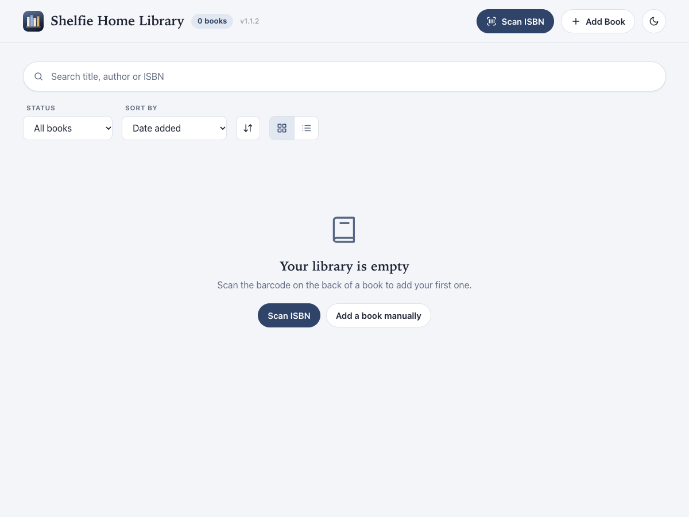
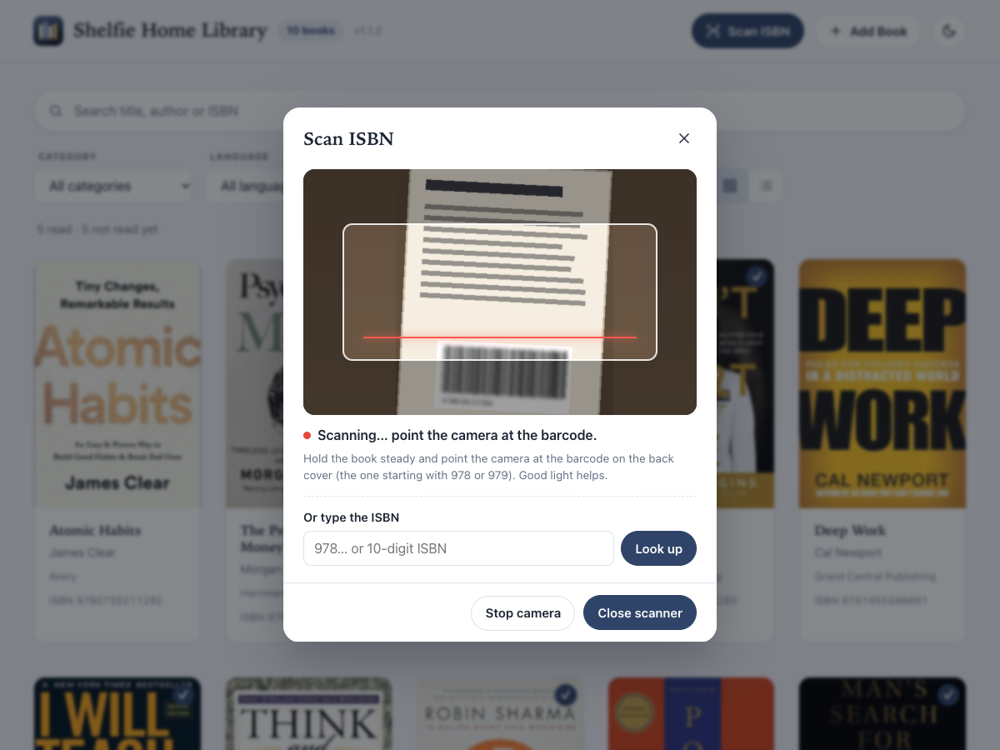
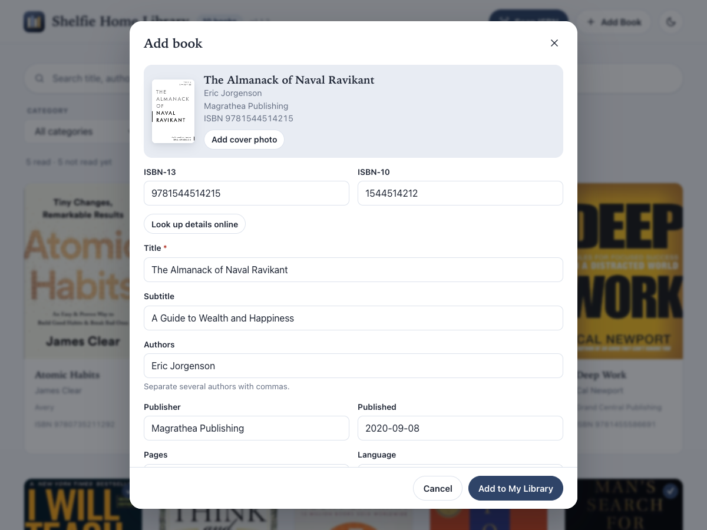
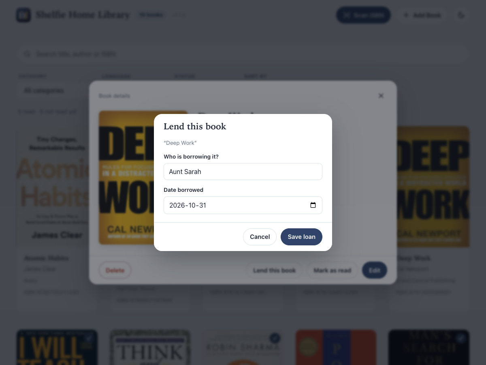

# Shelfie Home Library

**Keep a neat catalogue of every book you own, on your own computer.**

Shelfie is a free app for Mac and Windows. Point your camera at the barcode on the back of a book, and Shelfie fills in the title, author and cover picture for you. Then you can search your collection, mark what you have read, and remember who borrowed what.


## Who is it for?

Anyone with more books than they can remember. If you have ever bought a book you already owned, lent one to a friend and forgotten who has it, or wondered "have I read this yet?", Shelfie is for you. You do not need any technical knowledge to use it.

## What can it do?

* **Add books by scanning.** Hold the barcode up to your computer's camera, or type the number printed under it.
* **Fill in the details for you.** Title, author, publisher, description and cover picture are found automatically. You can change anything before saving.
* **Add books by hand.** Old books and books without a barcode can be typed in yourself.
* **Take a cover photo.** If a book's picture can't be found, photograph the cover and Shelfie straightens and crops it for you.
* **Find any book quickly.** Search by title, author or number. Narrow the list by category, language or whether you have read it.
* **Keep track of what you have read.** Tick a book as read and see your totals at the top.
* **Remember who has your books.** Note who borrowed a book and when, and mark it returned later.
* **Never add a book twice.** Scanning a book you already own simply opens the copy you have.
* **Light and dark looks.** Switch with the moon button at the top right.

**Your books stay private.** Everything is saved only on your own computer. There are no accounts, no sign-ups and no tracking.

## Download

Choose the file that matches your computer. These links always give you the newest version.

| Your computer | Download |
| --- | --- |
| **Mac** with an Apple chip (M1, M2, M3, M4 or newer) | [Shelfie-mac-arm64.dmg](https://github.com/milandawijekoon/home_library/releases/latest/download/Shelfie-mac-arm64.dmg) |
| **Mac** with an Intel chip | [Shelfie-mac-x64.dmg](https://github.com/milandawijekoon/home_library/releases/latest/download/Shelfie-mac-x64.dmg) |
| **Windows** (64-bit, which is almost every PC made in the last 10 years) | [Shelfie-Setup-win-x64.exe](https://github.com/milandawijekoon/home_library/releases/latest/download/Shelfie-Setup-win-x64.exe) |

[](https://github.com/milandawijekoon/home_library/releases/latest)

**Not sure which Mac you have?** Click the Apple logo in the top-left corner of your screen, then **About This Mac**. If you see "Apple M" followed by a number, choose the Apple chip download. If you see "Intel", choose the Intel one.

## Install

### On a Mac

1. Open the downloaded file ending in `.dmg`. It is usually in your **Downloads** folder.
2. A window appears. Drag the **Shelfie Home Library** icon onto the **Applications** folder.
3. Open **Applications** and double-click **Shelfie Home Library**.
4. The first time, your Mac may say it can't verify the app. Right-click (or hold Control and click) the app, choose **Open**, then click **Open** again. You only need to do this once.

**If your Mac says the app is "damaged and can't be opened":** the app is fine. Your Mac adds a safety label to everything downloaded from the internet and is strict about apps from small developers. To remove the label:

1. Click **Cancel**. Do not move the app to the Trash.
2. Open **Terminal**: press `Cmd + Space`, type `Terminal` and press Return.
3. Copy the line below, paste it into Terminal and press Return:

   ```bash
   xattr -cr "/Applications/Shelfie Home Library.app"
   ```

   Nothing appears on screen when it works. It only removes the label from this one app, and it does not touch your books.
4. Open the app again.

### On Windows

1. Double-click the downloaded `.exe` file (usually in your **Downloads** folder) and follow the steps on screen.
2. If a blue "Windows protected your PC" box appears, click **More info**, then **Run anyway**.
3. When it finishes, open **Shelfie Home Library** from the Start menu.

**If Windows says "Smart App Control blocked an app that may be unsafe":** Smart App Control is a strict Windows setting that blocks apps from small developers, and it has no "Run anyway" button. If you want to continue, open **Windows Security**, then **App & browser control**, then **Smart App Control settings**, and choose **Off**. Be aware that Windows will not let you turn it back on without resetting the PC, so only do this if you are comfortable with that. If you did not see this message, you can ignore this paragraph.

## How to use it

### 1. Start with an empty shelf

The first time you open Shelfie, your library is empty. You have two ways to add your first book.



### 2. Add a book by scanning

1. Click **Scan ISBN**. If your computer asks to use the camera, click **Allow**.
2. Hold the book steady and show the **barcode on the back cover** to the camera. It is the one with a long number starting with **978** or **979**. Good light helps.
3. When Shelfie reads it, the book's details appear.

No camera, or the barcode won't scan? Type the number into the **Or type the ISBN** box and click **Look up**.



### 3. Check the details and save

Look over what was found. Fix anything that is wrong, then click **Add to My Library**. The book now appears on your shelf.

### 4. Add a book by hand

For a book with no barcode, an older book, or one Shelfie can't find, click **Add Book** at the top. Fill in the form. Only the **title** and the **ISBN** (the number under the barcode) are required. Everything else is optional.



To give a book a cover picture, click **Add cover photo**. Hold the book upright facing the camera and keep it still, or choose a photo already saved on your computer. You can adjust the outline and crop before saving.

### 5. Open a book

Click any book to see its full details. From there you can:

* **Mark as read** (or **Mark as not read**).
* **Edit** the details.
* **Delete** the book (Shelfie asks you to confirm first).
* **Lend this book** (see below).


### 6. Lend a book to someone

Open the book and click **Lend this book**. Type who is borrowing it and pick the date. Later, open the same book and click **Mark as returned**. To see everything that is currently out, set the **Status** filter at the top to **Lent out**.



### 7. Find your books

* **Search:** type any part of a title, author, publisher, category or number into the search bar. The list narrows as you type.
* **Filter:** use the **Category**, **Language** and **Status** menus (All books, Read, Not read yet, Lent out).
* **Sort:** order by date added, title, author or publication date, and flip the order with the arrows button.
* **Change the view:** use the two small buttons on the right to switch between a grid of covers and a list.


### 8. Dark mode

Click the moon (or sun) button at the top right to switch between light and dark.


*Screenshots show sample books only. Cover images are from [Open Library](https://openlibrary.org) and belong to their respective authors and publishers.*

## Questions and answers

**Does it cost anything?** No. Shelfie is free and open source.

**Do I need the internet?** Only for two things: looking up a book's details and cover when you add it, and checking for a new version of the app. Browsing, searching and editing the books you have already added all work offline.

**Where are my books saved?** In a folder on your own computer, and nowhere else:

* Mac: `~/Library/Application Support/HomeLibrary`
* Windows: `%APPDATA%\HomeLibrary`

**How do I back up my library?** Shelfie has no export button. Instead, close the app and copy the folder above to a USB stick or cloud drive. To restore it later, copy the files back into the same place.

**What happens if I uninstall the app?** Your books stay in the folder above. Delete that folder yourself if you want them gone for good.

**Can two computers share one library?** Not automatically. Each computer keeps its own library.

**Does it update itself?** It checks for a new version in the background and offers to restart when one is ready. On a Mac, if the update can't install by itself, Shelfie tells you and opens the download page.

**Something went wrong. Where can I ask for help?** Please [open an issue](https://github.com/milandawijekoon/home_library/issues) and describe what you were doing and what you saw.

## Privacy

**This app does not collect any user data.** There are no accounts, no analytics and no tracking, and your library is never uploaded anywhere. The only internet requests Shelfie makes are to look up a book by its ISBN (Google Books, with Open Library as a backup) and to check for new versions of the app.

## For developers

You do not need this section to use the app.

```bash
npm install
npm start        # run the app in a browser at http://localhost:3000
npm run desktop  # run the desktop app
npm test         # unit, API and browser-UI tests (Node 20.19 or newer)
```

Release steps are in [docs/RELEASING.md](docs/RELEASING.md).

## License

Shelfie is open source under the [MIT License](LICENSE).
