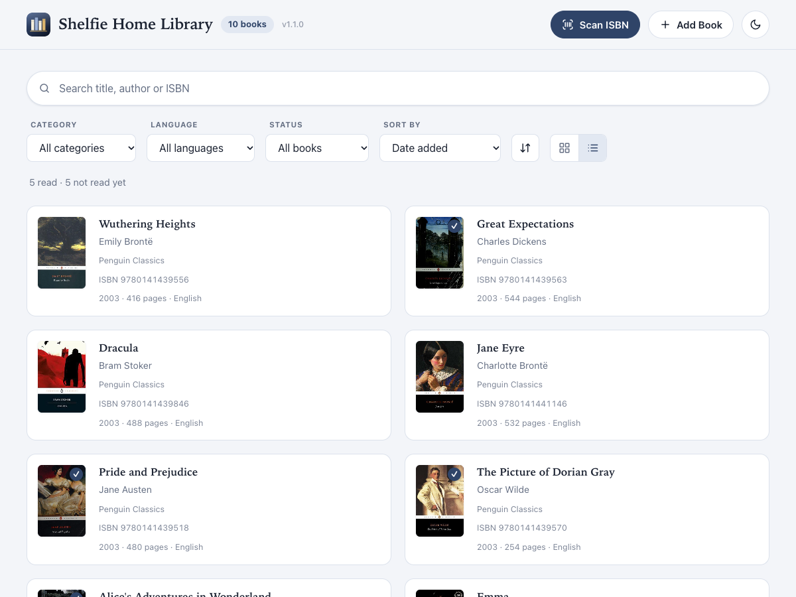

# Shelfie Home Library

A simple desktop app for cataloguing the books you own. Scan the barcode on a book (or type its ISBN), and the title, author, cover and other details are filled in for you. Search, filter and sort your collection, and keep track of what you have read.

## Features

* **Scan to add:** point your camera at a book's barcode, or type the ISBN.
* **Automatic details:** title, authors, publisher, description, categories and cover are looked up for you and can be edited before saving.
* **Add by hand:** books without a barcode or online record can be entered manually.
* **Cover photos:** photograph a book's cover and the app straightens and crops it for you.
* **Find things fast:** search by title, author, ISBN, publisher or category; filter by category, language or read status; sort and switch between grid and list views.
* **Reading status:** mark books as read and see your totals.
* **Lending:** note who you have lent a book to.
* **No duplicates:** scanning a book you already own opens its existing entry.

| Book details | List view |
| --- | --- |
|  |  |

*Screenshots show sample books only.*

## Download

These links always download the newest published release.

| Platform | Download |
| --- | --- |
| macOS, Apple silicon (M1 and newer) | [Shelfie-mac-arm64.dmg](https://github.com/milandawijekoon/home_library/releases/latest/download/Shelfie-mac-arm64.dmg) |
| macOS, Intel | [Shelfie-mac-x64.dmg](https://github.com/milandawijekoon/home_library/releases/latest/download/Shelfie-mac-x64.dmg) |
| Windows 64-bit | [Shelfie-Setup-win-x64.exe](https://github.com/milandawijekoon/home_library/releases/latest/download/Shelfie-Setup-win-x64.exe) |

Not sure which Mac you have? Open the Apple menu, then **About This Mac**: "Apple M…" means Apple silicon, "Intel" means Intel.

## Install

**macOS**
1. Open the downloaded `.dmg` and drag **Shelfie Home Library** into **Applications**.
2. Open it from Applications. The app is not yet signed by Apple, so the first time you may need to right-click it, choose **Open**, then confirm.

**Windows**
1. Run the downloaded `.exe` and follow the installer.
2. If Windows SmartScreen warns that the app is unrecognised, choose **More info**, then **Run anyway**.

## Use

1. Click **Scan ISBN** and allow camera access. Hold the barcode on the back cover (starting with 978 or 979) in front of the camera. You can also type the ISBN in the box under the camera.
2. Check the details that appear, edit anything you like, and click **Add to My Library**.
3. Click any book to see its details, mark it as read, edit it or delete it.
4. For books that aren't found, or have no barcode, click **Add Book** and fill in the form (only an ISBN and title are required).
5. To add a cover photo, press **Add cover photo** in the add/edit form. Hold the book upright facing the camera and keep it still, or choose a photo from your computer. You can adjust the outline and crop before saving.

The app checks for updates in the background and offers to restart when a new version is ready.

## Privacy

**This app does not collect any user data.** There are no accounts, no analytics and no tracking. Your library is stored only on your own computer, in the app's data folder, and is never uploaded anywhere:

* macOS: `~/Library/Application Support/HomeLibrary`
* Windows: `%APPDATA%\HomeLibrary`

The only network requests are to look up a book's details by its ISBN (Google Books, with Open Library as a fallback) and to check for new app versions. Uninstalling the app does not delete your library; remove the folder above if you want it gone.
